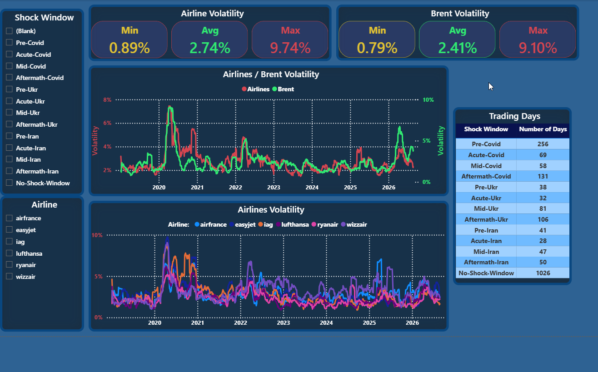
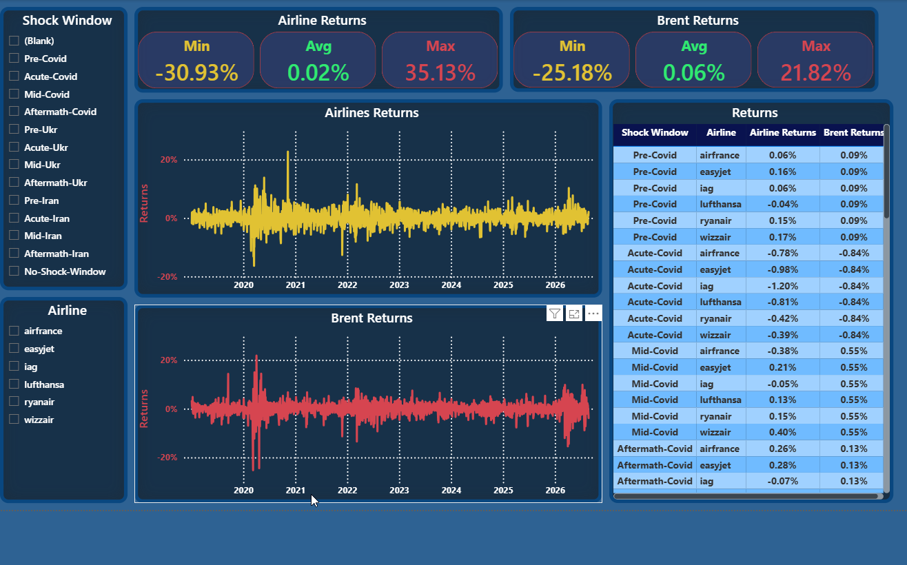
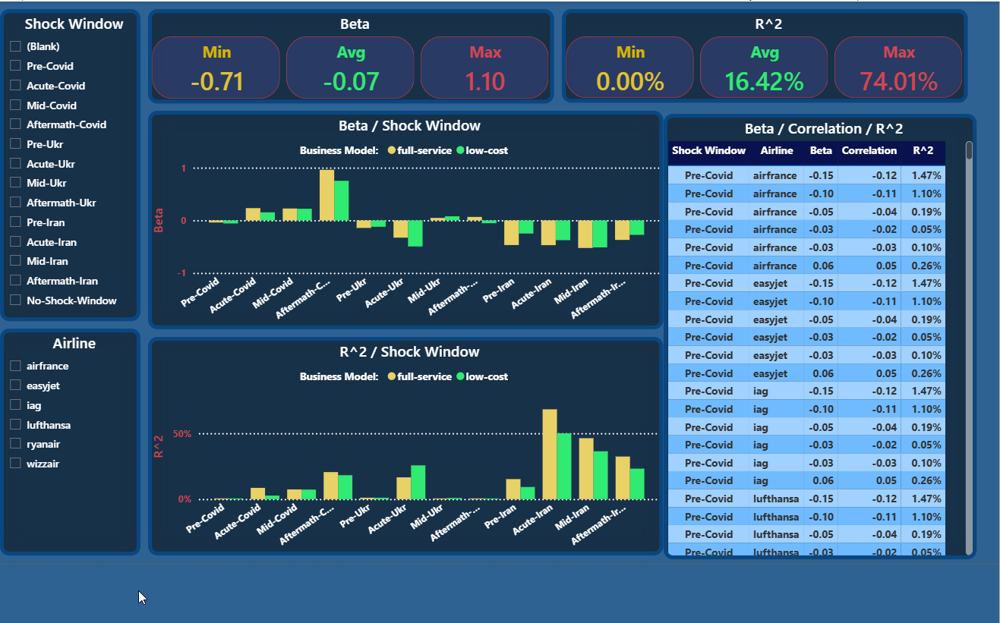

# EU Airlines vs. Oil Price Shocks: Exposure Analysis

## Overview

This project analyzes how EU airline stocks respond to oil price shocks,
comparing **low-cost** carriers (Ryanair, Wizz Air, easyJet) against **full-service** carriers
(Lufthansa, Air France-KLM, IAG) across 3 major market shocks between 2019 and 2026:
the Covid-19 crash, the Russia-Ukraine war and energy crisis, and the Iran-Israel-US conflict.

The goal was to answer, with real statistical evidence rather than assumption:
- Which airlines are most exposed to oil price shocks?
- Does business model (low-cost vs. full-service) predict that exposure?
- Does the relationship change depending on the *type* of shock (demand-driven vs. cost-driven)?
- How much of an airline's return can actually be explained by oil price movements?

This project was chosen mainly because I was fascinated by financial econometrics / time series analysis
and modeling since I was still a student at university.

## Tech Stack

- **Python / pandas** - data acquisition (yfinance) and cleaning / transforming
- **SQLAlchemy** - Python-to-SQL Server pipeline
- **SQL Server / T-SQL** - views, parameterized stored procedures, a cursor-based batch calculation,
window functions (LAG, STDEV)
- **Power BI** - interactive dashboard (3 pages)

## Data

- **Stocks**: 6 EU airlines, daily OHLCV, 2019-01-01 to 2026-08-25 via yfinance
- **Commodity**: Brent crude oil (BZ=F)
- **FX**: GBP/EUR and USD/EUR, used to convert all prices to a common EUR basis
- All prices converted to EUR; UK-listed tickers required an additional pence-to-pounds
correction (yfinance returns some UK tickers in GBp, not GBP)

## Methodology

## Cleaning
- Data was acquired from yfinance, then assigned my own tickers for readability and inserted into a dictionary
- Removed multiindexing, dropped volume column, fixed indexing
- Converted GBp to GBP for UK-listed stocks and Brent
- Converted everything to EUR currency as basis
- Outliers, missing values, duplicates check
- Final table construction
- Exported to SQL Server via SQLAlchemy library

### Metrics
- **Daily Return**: (close - prev_close) / prev_close
- **30-day rolling volatility**: rolling standard deviation of daily returns
- **Beta**: Σ(air_dev × oil_dev) / Σ(oil_dev²) - airline return sensitivity per unit of oil return
- **Correlation**: Σ(air_dev × oil_dev) / √(Σ(air_dev²) × Σ(oil_dev²))
- **R²**: correlation², i.e. the share of an airline's return variance explained by oil

### Periods analyzed

## Covid
- Pre Covid:		2019-01-01 to 2019-12-31, Trading Days: 256
- Acute Covid:		2020-01-01 to 2020-04-07, Trading Days: 69
- Mid Covid:		2020-04-08 to 2020-06-30, Trading Days: 58
- Aftermath Covid:	2020-07-01 to 2020-12-31, Trading Days: 131

## Ukraine War
- Pre Ukr:		2022-01-01 to 2022-02-23, Trading Days: 38
- Acute Ukr:		2022-02-24 to 2022-04-08, Trading Days: 32
- Mid Ukr:		2022-04-09 to 2022-08-03, Trading Days: 81
- Aftermath Ukr:	2022-08-04 to 2022-12-31, Trading Days: 106

## Iran War
- Pre Iran:		2026-01-01 to 2026-02-27, Trading Days: 41
- Acute Iran:		2026-02-28 to 2026-04-11, Trading Days: 28
- Mid Iran:		2026-04-12 to 2026-06-16, Trading Days: 47
- Aftermath Iran:	2026-06-17 to 2026-08-25, Trading Days: 50

## Key Findings

1. **Oil's explanatory power is highly regime-dependent.**
	R² is under 1% in calm periods but rises to 40-55% during the most acute phase of the 2026 Iran-Israel war.
2. **The sign of the relationship flips with the type of shock.**
	Demand-driven shocks (Covid-19) produced *positive* beta (oil and airlines fell together),
	cost-driven shocks (Ukraine, Iran) produced *negative* beta (oil up, airlines down).
3. **Business model's effect on exposure is shock-dependent, not universal.**
	Low-cost carriers were more exposed during the Ukraine cost-shock, probably because of Ukrainian
	airspace being closed. Full-service carriers were more exposed during Covid-19 and during the
	Iran-Israel conflict.
4. **Ukraine's effect decayed quickly while Iran's didn't.**
	Ukraine's elevated beta / R² was concentrated in the first 6 weeks and faded even though oil stayed high.
	Iran's elevated beta / R² persisted across the acute and mid phases.
5. **Markets price in anticipated shocks before they officially start.**
	Both the Ukraine and Iran windows show measurable activity in the weeks before the official conflict started.
6. **Very short analysis windows (under 30 trading days) are statistically unreliable.**
	An earlier version of this analysis with a 9-day acute Ukraine window produced inconsistent, unusable results;
	all shock windows were widened to clear this threshold.

## Limitations

- **The aftermath-Covid period result is likely inflated by spurious correlation.**
	Oil and airline stocks were both recovering for unrelated reasons: oil's own rebound from its April 2020
	crash, and airlines rallying on vaccine-development news. Over the same months, two co-trending series
	can show artificially high correlation with no real causal link. Testing this properly would require
	cointegration analysis, which is outside this project's scope.
- **The Gaza conflict (Oct 2023 to present) was not modeled as a separate period.**
- **The short June 2025 Israel-Iran escalation was tested as a single standalone window, not split into
	sub-phases like the other events**, since it lasted only 12 days in total and was not included in this
	write-up's period table; see the project notebook for that result.
- **Beta, correlation, and R² are simple single-factor statistics.** They do not control for broader market
	movement (e.g. the S&P 500) or isolate oil-specific effects from macro sentiment.

## Dashboard

*Page 1: Daily Volatility overview, slicers and summary cards.*

*Page 2: Daily Return trends for airlines and Brent crude*

*Page 3: Beta, correlation, and R² by period and airline.*
